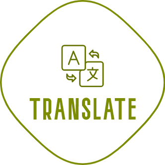

<p align="center">

</p>
<p align="center"> <a href="./README.md">English</a> | 简体中文</p>

vscode扩展  ——  中英文滑词翻译

## :coffee:

[请我喝一杯咖啡](https://github.com/Simon-He95/sponsor)

## License

[MIT](./license)

## 本地（离线）翻译

插件支持可选的本地 HTTP 翻译服务（离线）。

1）建议创建 venv 并安装 Python 依赖：

```bash
python3 -m venv .venv
source .venv/bin/activate
pip install -r local_server/requirements.txt
pip install torch
```

2）打开设置：

- `translate.useLocal`: true
- `translate.local.autoStart`: true

默认启动命令为 `python3 -u local_server/app.py --host 127.0.0.1 --port 0`。

如果使用 venv，建议设置：

- `translate.local.command`: `./.venv/bin/python -u local_server/app.py --host 127.0.0.1 --port 0`

### 完全离线（不依赖网络）

如果你希望 **完全不走网络**（不自动下载模型），需要你提前把模型文件放到本机。

- 设置 `translate.local.offline`: true
- 然后提供其一：
	- `translate.local.model.root`: 一个目录，里面包含 `en-zh/` 和 `zh-en/` 两个模型目录
	- 或者分别设置 `translate.local.model.enZh`、`translate.local.model.zhEn` 为本地路径

说明：
- 离线模式下服务会使用 `local_files_only=true`，缺文件会直接报错（不会尝试联网下载）。
